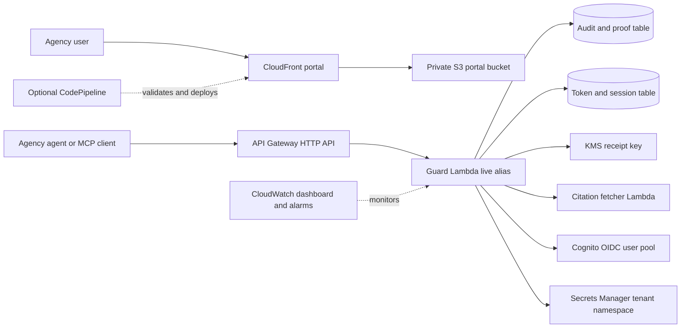

# Single-tenant deployment runbook

This runbook deploys one isolated Kenning Trusted Agent instance in a
customer AWS account. The CloudFormation stack is regional. DynamoDB, Lambda,
KMS, Secrets Manager, Cognito, API Gateway, and CloudWatch resources stay in
the selected stack region. CloudFront is a global service. An ACM certificate
for a custom portal hostname must be in `us-east-1`.

The package is in [`infra/single-tenant/`](../infra/single-tenant/). The
deployment command is [`scripts/deploy_single_tenant.sh`](../scripts/deploy_single_tenant.sh).
It does not use GitHub Actions.

## What the package creates



The template provisions:

- two encrypted, on-demand DynamoDB tables with PITR and TTL;
- an RSA KMS signing key and alias;
- Python Guard and Node.js Citation Trust Lambda functions;
- an API Gateway HTTP API with a 29-second integration timeout;
- a private S3 portal bucket and CloudFront Origin Access Control;
- Cognito User Pool, Managed Login domain, and public OIDC client;
- a tenant-scoped Secrets Manager namespace;
- Lambda, API Gateway, DynamoDB, and CloudFront alarms plus a dashboard;
- an optional CodeConnections → CodeBuild → manual approval → CodeBuild
  CodePipeline; and

Every application request is pinned to `AgencySlug`. A credential or request
for another workspace is rejected, including an administrator credential.
Resource names, tags, callback URLs, and portal branding come from parameters.
Hosted Kenning account IDs and endpoint IDs are not used by the package.

## Prerequisites

The operator needs:

- AWS CLI v2, `jq`, `tar`, `git`, Python 3.11 or later, Node.js 22, and npm;
- permission to create the resources listed above and
  `CAPABILITY_NAMED_IAM` approval;
- a private S3 bucket name for release artifacts; the deployment command can
  create it if the name is available; and
- no hosted Kenning account, endpoint, or sender address. Marketing-site
  contact delivery is not part of the public package.

For a custom hostname, request an ACM certificate in `us-east-1` and validate
it before deployment. The stack uses the CloudFront hostname when
`PortalDomain` is empty.

## Deploy a client-managed instance

Start with a clean checkout and validate the package:

```bash
git switch main
git pull --ff-only
python3 scripts/validate_single_tenant_package.py --region "$AWS_REGION"
```

Copy the parameter example. Keep this file outside source control when it
contains customer-specific values. It must not contain PATs, passwords, or
secret values.

```bash
cp infra/single-tenant/client-parameters.example.json \
  infra/single-tenant/client-parameters.json
```

Set at least `AgencyName`, `AgencySlug`, and `LambdaArtifactBucket`. Set
`PortalDomain` and `PortalCertificateArn`
together, or leave both empty. Set `AllowPatBootstrap` to `true` only for the
first owner setup. Keep `CreateClientPipeline` false for a manual deployment.

Apply the stack:

```bash
export AWS_REGION=ap-southeast-2
./scripts/deploy_single_tenant.sh deploy \
  --stack-name kta-example-agency \
  --parameters-file infra/single-tenant/client-parameters.json \
  --artifacts-dir .single-tenant-artifacts
```

The command builds deterministic Lambda and portal artifacts, uploads them to
the private artifact bucket, applies the stack, publishes `api-config.js` and
`branding.json` to the private portal bucket, and invalidates CloudFront. It
prints only non-secret outputs: stack, region, workspace ID, API URL, portal
URL, and release ID.

The first deployment target is the customer account. The package validation
and build gates can run in a separate development account, but customer data
must not be copied into that account.

## Bootstrap the first workspace owner

Create a short-lived bootstrap PAT in the new token table. The plaintext PAT
is printed once by the command. Keep it in a protected shell variable and
revoke it after the browser owner session exists.

```bash
export TOKEN_TABLE_NAME="kta-example-agency-production-tokens"
BOOTSTRAP_OUTPUT="$(AWS_REGION="$AWS_REGION" TOKEN_TABLE_NAME="$TOKEN_TABLE_NAME" \
  python3 scripts/manage_pat.py create \
    --name agency-bootstrap \
    --tenant-id example-agency \
    --expires-in-days 1)"
export KENNING_PAT="$(printf '%s\n' "$BOOTSTRAP_OUTPUT" | awk -F': ' '$1 == "token" {print $2}')"
BOOTSTRAP_TOKEN_ID="$(printf '%s\n' "$BOOTSTRAP_OUTPUT" | awk -F': ' '$1 == "token_id" {print $2}')"
```

Initialise the tenant configuration and create the owner membership through
the controlled PAT bootstrap path:

```bash
export KENNING_API_URL="$(aws cloudformation describe-stacks --region "$AWS_REGION" \
    --stack-name kta-example-agency \
    --query 'Stacks[0].Outputs[?OutputKey==`ApiEndpoint`].OutputValue | [0]' \
    --output text)"
./scripts/deploy_single_tenant.sh init \
  --api-url "$KENNING_API_URL" \
  --tenant-id example-agency \
  --retention-days 365 \
  --legal-hold-default false

curl --fail-with-body -sS -X POST "$KENNING_API_URL/auth/session" \
  -H "Authorization: Bearer $KENNING_PAT" \
  -H 'Accept: application/json' >/dev/null
```

Set `AllowPatBootstrap` to `false` in the parameter file and redeploy. Revoke
the bootstrap PAT. Do not place the PAT in a file, ticket, log, or parameter
file.

```bash
AWS_REGION="$AWS_REGION" TOKEN_TABLE_NAME="$TOKEN_TABLE_NAME" \
  python3 scripts/manage_pat.py revoke --token-id "$BOOTSTRAP_TOKEN_ID"
unset KENNING_PAT BOOTSTRAP_OUTPUT BOOTSTRAP_TOKEN_ID
```

The agency administrator can now use Cognito Managed Login. The portal uses
the CloudFront or configured custom hostname callback URL created by the
stack.

## Validate the deployment

Record the following without recording credentials:

```bash
aws cloudformation describe-stacks --region "$AWS_REGION" \
  --stack-name kta-example-agency \
  --query 'Stacks[0].{status:StackStatus,outputs:Outputs}'
```

Required checks:

1. `GET /health` returns `status=ok`, the expected release ID, and the expected
   source commit.
2. `GET /auth/config` reports OIDC enabled.
3. A Guard evaluate request for `AgencySlug` returns the expected decision.
4. A request for a different workspace returns HTTP 403 with
   `single_tenant_mismatch`.
5. CloudFront serves `/app/` and the portal can start the OIDC flow.
6. DynamoDB PITR and TTL are enabled; the KMS key has rotation enabled.
7. CloudWatch alarms are present and an on-call notification action is
   attached according to agency policy.

Run the package and application checks before handoff:

```bash
python3 scripts/validate_single_tenant_package.py --skip-cloudformation
npm --prefix portal run build
npm --prefix portal run lint
```

Run the deployed boundary smoke test with the short-lived validation PAT:

```bash
KENNING_API_URL="$KENNING_API_URL" \
KENNING_PAT="$KENNING_PAT" \
KENNING_TEST_TENANT_ID=example-agency \
  ./scripts/single_tenant_smoke_test.sh
```

The client account owner must run the deployed API and browser smoke checks
with the customer hostname. The first release should be marked Development
validation until an operator other than the package author records the smoke
result.

## Optional CodePipeline

Set these parameters to create the client-managed pipeline:

- `CreateClientPipeline=true`;
- an existing `SourceConnectionArn` for the agency Git provider;
- `RepositoryId` and `BranchName`; and
- a committed `infra/single-tenant/client-parameters.json` with no secrets.

The pipeline runs package validation, pauses at a manual agency approval, and
then runs the deploy CodeBuild project. The CodeBuild role can update only the
stack's deployment workflow and the resources required by the package. Review
the generated policy with the agency security team before enabling automatic
use.

AWS CodeConnections, CodePipeline, and CodeBuild are the supported release
path. Do not add a GitHub Actions deployment workflow.

## Ownership boundary

Release 1.0 supports `DeploymentMode=client-managed` in an AWS account owned
or controlled by the operator. The public package does not require a Kenning
account, Kenning role, Kenning endpoint, or Kenning contact mailbox. Any
operator access role is outside this package and must follow the operator's
own trust policy, approval, session, monitoring, and revocation controls.

## VPC, backup, and disaster recovery

To place Guard Lambda in private subnets, set both `VpcSubnetIds` and
`VpcSecurityGroupIds`. The agency must provide NAT or the required VPC
endpoints for DynamoDB, KMS, Secrets Manager, Cognito, Lambda, CloudWatch
Logs, and any configured external identity provider. A VPC setting without
these routes can make Guard fail closed.

The package enables DynamoDB PITR, S3 versioning, and retain policies for
audit, token, portal, KMS, Cognito, and secret resources. Test recovery before
production:

1. Record a recovery point and a release manifest.
2. Restore both DynamoDB tables to an isolated recovery name.
3. Restore or verify the KMS key and Cognito user pool retention state.
4. Deploy a new stack slug in the recovery region/account.
5. Upload the same immutable Lambda and web artifacts.
6. Validate `/health`, an allow decision, an approval decision, and portal
   sign-in before switching DNS.
7. Record the restore duration, data point, operator, and unresolved gaps.

The package does not claim an air-gapped deployment. Citation Trust fetches
outside source URLs by design. An air-gapped customer must disable that
integration or provide a reviewed, vendored fetcher and private service
endpoints. This is a documented stretch path, not a hidden network call.

## Removal and cost control

Do not delete the stack as a routine rollback. Audit and token tables,
CloudFront portal data, KMS, Cognito, and secrets use retain policies. Follow
the agency's legal hold and backup policy first. For an approved retirement,
export the release evidence, revoke credentials, disable the pipeline, and
then remove resources in a reviewed change window.

## Upgrade, rollback, and support

Build a new immutable artifact from the approved source commit, validate it
in an isolated stack, and update the existing stack with the new artifact
keys, release ID, source commit, and version. Record the health response and
smoke result before changing traffic. Rollback means restoring the prior
validated artifact and compatible parameters; it does not undo data writes or
schema changes.

AWS account, identity, DNS, quota, backup, and incident response support stays
with the operator. Public code and documented package defects can be reported
through [SUPPORT.md](../SUPPORT.md). Azure and Kenning-managed hosting are not
supported by release 1.0.0.
